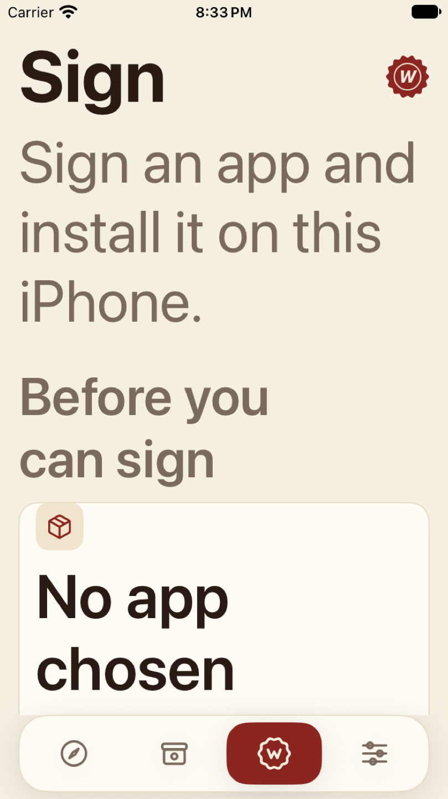
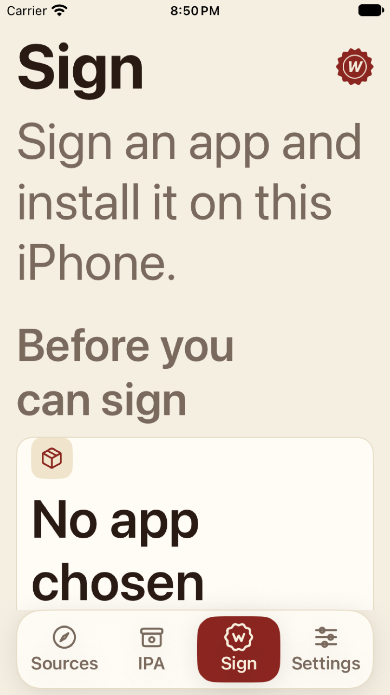

# Wax UI audit implementation report

Started2026-10-29; verification continued2026-10-30. Local branch: `codex/wax-ui-audit-improvements`. Implementation uses an isolated worktree. The original checkout, its uncommitted files, real phone apps and signing credentials remain unchanged by this audit.

## Changes

| Change | Files | Verification / boundary |
|---|---|---|
| Truthful shelf status and Retry Save | App/SignView.swift | Existing shelfSaveState drives idle/saving/saved/failed; retained export stays outside saved branch. Source regression red/green/revert/green plus app-model failed-save/retry coverage. Fault-specific result screen was not captured. |
| Named deletion alert | App/ContentView.swift | Native alert has Cancel and Delete IPA. Two disposable simulator fixtures prove cancellation preserves the index/file and confirmation removes only the selected index/file. No phone data deleted. |
| Reduce Motion press effects | App/Theme.swift; App/WaxTabBar.swift | Shared primary/tab styles suppress press scale/animation when enabled. Source regression verified; manual vestibular/VoiceOver testing remains open. |
| Adaptive labels, rows and pills | App/Theme.swift; App/WaxTabBar.swift; App/SignView.swift | Settings rows stack at accessibility sizes, pills can grow, setup titles wrap, tab names remain visible. Tab-label size is bounded at xxxLarge; content keeps the requested AX size. Final small-screen test recognizes all four visible labels with Vision OCR and verifies tab buttons remain under100pt tall. |
| Hidden signing animation eligibility | App/SignView.swift | Existing WaxMelt visibility input receives actual selected tab. Scene phase/Reduce Motion/completion gates remain. Source regression verifies wiring; no measured battery/CPU speedup claimed. |
| More accurate wording | App/ContentView.swift; App/SignView.swift | Unsigned guidance separates originals from signed outputs. Configured host says Configured, not Ready. |
| Preserve prior local work | App/BugReportView.swift; notification/report source and tests | Existing uncommitted report preview, shake preference and notification serialization copied into the isolated baseline, not overwritten. UI report editing/reset/navigation and model tests pass. |

## Results

| Check | Actual result |
|---|---|
| Complete Swift package baseline |843 executed:825 passed,18 skipped,0 failures. Core package source did not change after this run. |
| Fresh BugReportTests repeat |4 passed,0 failures |
| Final app-model suite |111 passed,0 failed,0 skipped, including retained signed output after failed save and retry |
| Final standard iPhone17 UI run |3 passed,1 failed,0 skipped: navigation/report reset, deletion cancellation and confirmed deletion pass; automated accessibility audit fails |
| Final small iPhone SE / AX5 run |2 passed,0 failed,0 skipped: adaptive journey and pixel-OCR visible-tab regression |
| Large iPhone18 Pro Max / dark |1 passed,0 failed,0 skipped: adaptive journey; actual dark screenshots inspected |
| Source/UI policy checks |9 passed (structural contracts, not behavioral UI tests) |
| Build-channel checks |6 passed |
| Permission prompt source check |1 passed |
| Normal Release |Built and ran through XCTest; no developer controls added |
| Development |Built while running the111 model tests; no release produced |
| Independent source review |No proven production regression; behavioral deletion coverage added after review concern. Final follow-up recorded separately. |
| Free three-model panel |Incomplete:0/3. The free-only guard refused the model. No paid fallback or policy bypass. |

The automated accessibility failure remains **“Dynamic Type font sizes are unsupported”**, with detail **“User will not be able to change the font size of this SwiftUI.AccessibilityNode”**. XCTest associates a small element crop with the install-host setup area. Source styles are scalable, but this audit has not established whether the remaining report is a framework audit limitation or another combined-element defect. It was not filtered out or converted into a pass. The PR must remain a draft.

Three existing compiler warnings remain in LibraryModel, OTAInstallModel and WaxMelt; the model run also emitted an existing main-thread diagnostic in RuntimeIdentityTests. These are not represented as new clean-Swift6 results.

## Before/after evidence

The primary comparison uses the same iPhone SE simulator, light appearance and AX5 content size. The earlier attempt let tab titles grow excessively; screenshots caught that regression before the final bounded-label version. A test that queried child StaticText nodes was also invalid because the button combines accessibility children; the final test reads actual visible pixels with Vision OCR instead.

Settings top comparisons are in `screenshots/before-small-ax-settings.png` and `screenshots/after-small-ax-settings.png`. Standard deletion and large dark appearance are separate representative captures, not a falsely matched before/after pair. The screenshot manifest records source capture names and hashes. Public images contain synthetic simulator data only and were resized without changing content. Full XCTest attachments, videos, logs and result bundles stay local to avoid repository bloat.

## Test failures investigated

1. Initial navigation harness expected the placeholder as the cleared field value. The real field returns an empty string; corrected expectation. Navigation then passed.
2. Native confirmationDialog on this iOS displayed a popover without a visible Cancel action. Replaced with a native alert and captured the value passed to its action. Both cancellation and actual removal now pass.
3. A large-text tab fix first created a very tall bar. Bounded navigation-label text while keeping content AX5; actual-pixel test and height guard now pass.
4. The remaining automated Dynamic Type audit failure remains open as described above.

## Scope and evidence gaps

No signing algorithms, credential material, profile enforcement, archive integrity, library transaction logic or job ownership were changed. Library search, direct-download job cards, cancellation redesign, cold-source loading and large-library lazy rendering remain proposals rather than unmeasured rewrites.

Manual VoiceOver, Bold Text, Increase Contrast, Differentiate Without Color, display zoom, the orientation matrix, physical shake, full source networking, every credential-dependent success/error state, Instruments hitch/energy profiling and real-phone signing/install regressions were not completed for this branch. Prior phone tests do not substitute for them. No private IPA or certificate was uploaded. Nothing was merged, deployed or released.

## Publication

[Draft PR33](https://github.com/dylldev/wax-signer/pull/33) is open on `codex/wax-ui-audit-review`. The public branch starts from fetched public main; private local Git history is not an ancestor. A scan of the final tracked tree found zero matches against the existing private denylist. The original working checkout remains at518156f with its existing uncommitted work preserved.

Initial public commit groups:

- `6de9d0fe3905`: Bring existing tested Wax feature work into the UI audit baseline
- `87af4ad1e09b`: Fix save feedback, deletion safety and accessible Wax controls
- `cd85618fc779`: Test real Wax navigation, deletion and large-text rendering
- `d7313b6a65da`: Document the Wax UI audit, scorecard and remaining validation gaps

The PR remains draft because the accessibility audit and full free-only review are incomplete. GitHub CI is separate from the recorded local simulator results; inspect the live PR checks for its current status. No merge or release occurred.

The two deletion UI tests require prepared disposable simulator entries named Wax UI Cancel and Wax UI Delete; they skip with an explicit fixture message on a fresh unprepared simulator. The recorded successful run used only synthetic copies of the repository test IPA. The existing navigation and adaptive tests run without that fixture. No production test hooks or developer switches were added to normal Wax.
